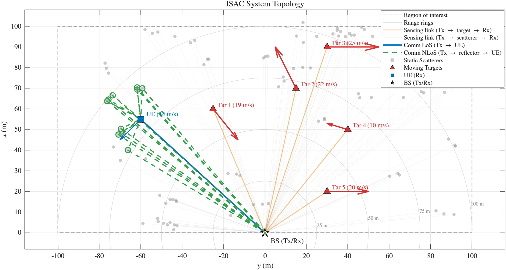

# Probabilistic Denoising-Enhanced ISAC for Stochastic Cluttered Mobile Environments

This work is currently under review for publication in the IEEE Transactions on Wireless Communications.

Reference implementation for **PDISAC** — a monostatic PMCW integrated sensing and communication (ISAC) framework for stochastic, cluttered, mobile environments.


---

## Abstract

We propose Probabilistic Denoising ISAC (PDISAC), a framework built on a **multi-bit slot-partitioned ISAC waveform**: by partitioning each maximal-length sequence into alternating pilot and data slots, we embed multiple bits per sequence through symbol-level spreading, multiplying the data rate while every chip retains the deterministic radar code. The added throughput, however, injects data-dependent, non-white sidelobes into the range-Doppler (RD) heatmap that degrade matched-filter (MF) sensing. Rather than modifying the MF receiver, we develop **RDPDNet**, a lightweight probabilistic denoising network inserted between RD-map formation and constant-false-alarm-rate (CA-CFAR) detection; trained with an **adversarial frequency-mixup (AFM)** mechanism, it suppresses the data-induced sidelobes and thermal noise without knowledge of the embedded symbols. We further characterize the statistics of the geometry-determined channel, and analyze the fundamental limits through a closed-form Cramér–Rao lower bound (CRLB), a semi-analytical bit error rate (BER), and an average capacity that tie the slot allocation and sequence length to the sensing–communication trade-off. Over a realistic urban geometry, RDPDNet absorbs most of the data-embedding sensing penalty and markedly lowers the RMSE at low SNR, while increasing the slot allocation raises the data rate at the cost of a higher BER — a tunable sensing–communication trade-off.

## Repository layout

```
PDISAC/
├── simulation_matlab/   MATLAB: waveform + channel simulation, dataset generation, and evaluation
│                        (main1 … main9b). See simulation_matlab/README.md
├── alg_pdisac/          Python: RDPDNet + AFM training and the MATLAB↔Python inference bridge.
│                        See alg_pdisac/README.md
├── LICENSE
└── README.md            (this file)
```

The two sides are coupled through files on disk: MATLAB writes the training dataset into `alg_pdisac/data/`, Python trains RDPDNet and writes a checkpoint into `alg_pdisac/exps/`, and MATLAB reads that checkpoint back through a Python inference bridge during evaluation.

## Requirements

**MATLAB** (tested on R2022b+), with:

- Phased Array System Toolbox (`phased.Platform`, `physconst`)
- Database Toolbox (`sqlite`, `sqlwrite`) — used to write the training dataset `.db`
- Signal Processing / base MATLAB (`fft`, `cart2sph`, `exportgraphics`, `readtable`/`writetable`)

**Python 3.13.14** (a conda environment is recommended), with the packages in
[`alg_pdisac/requirements.txt`](alg_pdisac/requirements.txt):

```bash
conda create -n pdisac python=3.13.14 -y
conda activate pdisac
pip install -r alg_pdisac/requirements.txt
```

## End-to-end pipeline

The full pipeline is: **MATLAB generates data → Python trains RDPDNet → MATLAB evaluates**.

**1. Generate the training dataset (MATLAB).**
Run `generate_radar_dataset.m`; it writes `alg_pdisac/data/dataset_train.db`. For a quick end-to-end check, set the environment variable `PDISAC_SMOKE` first to write the small `dataset_smoke.db` instead.

```matlab
% in simulation_matlab/
generate_radar_dataset          % → alg_pdisac/data/dataset_train.db
% setenv('PDISAC_SMOKE','1'); generate_radar_dataset   % → dataset_smoke.db (quick)
```

**2. Train RDPDNet (Python).**
From `alg_pdisac/`, run the trainer. Real training reads `dataset_train.db`; setting `PDISAC_SMOKE=1` switches everything (dataset, epochs, folds, device) to the fast smoke configuration. The checkpoint is written to `exps/pdnet_afm/checkpoints/best_checkpoint.pth`.

```bash
cd alg_pdisac
python -m scripts.train                 # real training  → dataset_train.db
PDISAC_SMOKE=1 python -m scripts.train    # quick smoke     → dataset_smoke.db
```

**3. Evaluate the pipeline (MATLAB).**
Point `PDISAC_cfg.inference.python_executable` in `simulation_matlab/main1_matlab_config.m` at your Python environment, then run the ML-sensing evaluation. `main9`/`main9b` call the trained RDPDNet through the Python inference bridge and reproduce the sensing figures (RMSE vs SNR, bias significance, RD/AFM maps).

```matlab
% in simulation_matlab/
main9b_ml_sensing
```

`PDISAC_SMOKE` is the single switch shared by MATLAB (dataset generation) and Python (training config), so one variable flips the whole pipeline between the full run and the smoke run.

## Details

- **MATLAB side** (waveform, channel, sensing/comm processing, analysis, dataset generation, evaluation): see [`simulation_matlab/README.md`](simulation_matlab/README.md).
- **Python side** (RDPDNet + AFM, training/inference, configuration): see [`alg_pdisac/README.md`](alg_pdisac/README.md).

## License

See [`LICENSE`](LICENSE).
